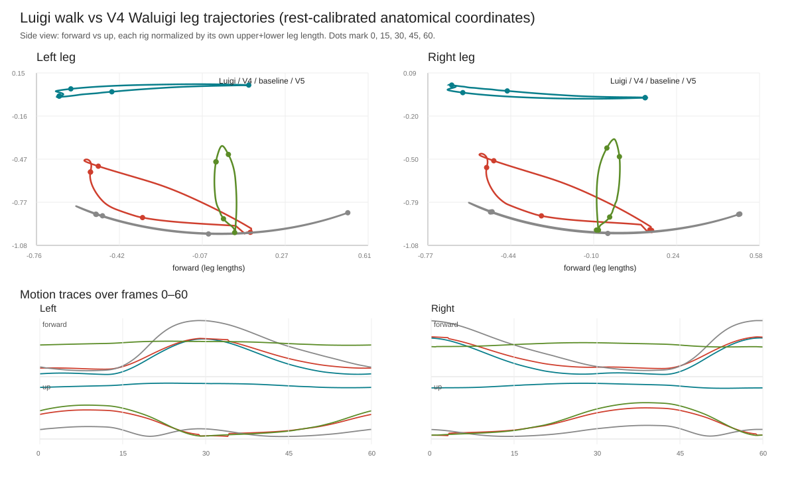

# Direct Galaxy walk geometric legs, V5

## Scope and preservation

V5 starts from the disposable V4 preview and changes only the Waluigi leg adapter, measured contact root translation, and copied preview action. It does not open or write the production rig. The V4 arm, wrist, hand, and finger action curves are copied unchanged; the reopened preview measures zero arm/fist basis difference at every quarter frame. Object scale remains `43.437`, the two original bound meshes and materials remain in place, and the baked action has no runtime constraints.

The preview is written only after trajectory, reach, arm-preservation, segment, foot mesh, grounding, and finite-transform gates pass.

## V4 failure diagnosis

The leg path in V4 did not use the anatomical frame already used by its arm path. It mapped source vectors through object transforms only. Rest geometry shows:

- Luigi up is `+Z`; its foot/toe direction is `+X`.
- Waluigi up is `+Y`; its foot/toe direction is `+Z`.
- The measured proper rotation maps Luigi `+X forward` to Waluigi `+Z forward`, Luigi `+Z up` to Waluigi `+Y up`, and Luigi `-Y lateral` to Waluigi `-X lateral`.
- The map has determinant `+1`: the limbs keep their anatomical side sign and do not require a reflection. Luigi's object basis is identity at scale 1. Waluigi's object basis keeps the intentional `43.437` scale and 90° X rotation; that presentation transform is preserved, while the retarget map is solved in each character's own rest-calibrated frame.

V4's object-only mapping instead sent Luigi forward motion into Waluigi's lateral axis and Luigi vertical motion into Waluigi's forward axis. The leg solver therefore interpreted steps and gravity in the wrong anatomical directions. Its source joint origin was also Luigi's torso `Hip`, while its target origin was the Waluigi thigh head. The source `Hip` to ankle rest distance is `42.826`; the actual source thigh-to-knee-to-ankle chain is `34.190`. The extra `13.65` units are the pelvis-to-thigh offset, which V4 added again to the target leg path. This pushed samples to the target reach limit and produced nearly straight knees.

The target foot path also has an offset helper branch: aiming `bone_9`'s own axis did not aim the actual `bone_12` toe endpoint. V4's mean source-to-target toe direction mismatch was about `63–67°`. V4 also replaced the already validated walk's leg outputs with its own IK solution, so its solver could not inherit the approved leg trajectory. Its hardcoded left stance window `29–34` continued after Luigi lifted that foot; the right window missed the beginning of the late landing. Source ankle world trajectories identify left support at `29.75–30.25`, right support at `0–0.75`, and the loop seam at `58.75–60`. Low-speed samples at left 11 and right 41 are swing apexes because the foot is high. The approved baked baseline by itself has almost straight knees (`0.002–0.008 rad`); source walk flexion reaches about `1.67 rad`, so these limbs must be solved from Luigi's trajectory instead of inheriting the baseline's knee angles.

## V5 method

V5 constructs right-handed rest frames from the spine/pelvis up vectors and actual toe-chain forward vectors. It measures source chain lengths from joint-head distances, converts the source thigh/knee/ankle points through that anatomical rotation, and scales by target/source chain length. The source thigh-to-knee-to-ankle length is `34.190`; the Waluigi armature-space length is `1.70067`, giving a local conversion ratio of `0.0497417`. A two-bone analytic solve uses the mapped source knee as its signed pole. Reopened pole alignment remains `0.9977–1.0` on the right and `0.9995–1.0` on the left. It aims the whole Waluigi foot branch by aligning the evaluated ankle-to-toe endpoint vector, not `bone_9`'s unrelated rest axis.

Ground correction follows the corrected source gait. The weighted foot mesh is sampled during source-supported stance, its sole clearance is measured, and a smooth root-height translation is derived from those measurements. The profile is `0.286–5.053` world units on `bone_6`; it changes neither object scale nor arm/fist local curves. Each stance then anchors the evaluated weighted foot mesh. The prior root bob and all non-leg action channels remain copied from V4.

## Numerical result

All source and target motion measurements use each character's own rest-calibrated anatomical frame and total leg length. The audit evaluates 241 samples from frame 0 through 60 at 0.25-frame spacing.

| Metric | V4 left/right | V5 reopened left/right |
|---|---:|---:|
| Ankle trajectory RMSE, normalized | `0.916 / 1.247` | `0.00042 / 0.00177` |
| Knee trajectory RMSE, normalized | `0.586 / 0.854` | `0.1023 / 0.1021` |
| Knee flex RMSE | `0.235 / 0.253 rad` | `0.0146 / 0.0215 rad` |
| Worst flex error | — | `0.1148 rad` |

V5 maximum solver ankle error is `3.64e-7` armature units before bake. The saved/reopened action's maximum pose-matrix error against the pre-save action evaluation is `5.96e-7`; maximum leg segment-length error is `1.04e-5` armature units. The rest-calibrated toe endpoint direction error averages `0.0062°` and peaks at `0.0341°` before contact anchoring.

Reopened mesh checks report stance centroid sliding of `0.109` world units left and `0.011` right. Stance sole clearance is `[-0.149, 0.111]` left and `[-0.103, 0.065]` right. Worst all-frame ground penetration is `0.149` world units. The one visible character consists of one target armature and its two bound meshes; the object scale is unchanged and no pose constraints remain.

The trajectory overlay compares Luigi, V4, the approved leg baseline, and reopened V5 in side view and over time:



## Review candidate

Local preview: `tools/blender/reports/direct_luigi_walk_v5_geometric_legs.blend`.

Inspect frames 0–1 (right stance), 11–12 (left swing apex), 15 (mid-swing), 29.5–30.5 (left stance), 41 (right swing apex), 45, and 58.5–60 (right landing and loop seam). The key comparison is side-on: Luigi and V5 should step in the same forward/back direction, while V5 keeps Waluigi's leg lengths and knee bend. Confirm the measured root bob looks grounded and the accepted arms/fists still read the same relative to the torso.

## Repeatable commands

Run from the worktree root with Blender 5.2.3:

```powershell
& 'C:\Program Files\Blender Foundation\Blender 5.2\blender.exe' --background tools/blender/reports/direct_luigi_walk_v4_contact.blend --python tools/blender/audit_direct_walk_legs.py -- --output tools/blender/reports/direct_walk_leg_trajectory_audit.json
& 'C:\Program Files\Blender Foundation\Blender 5.2\blender.exe' --background tools/blender/reports/direct_luigi_walk_v4_contact.blend --python tools/blender/prototype_direct_luigi_walk_legs_v5.py -- --report tools/blender/reports/direct_luigi_walk_v5_legs.json --preview tools/blender/reports/direct_luigi_walk_v5_geometric_legs.blend
& 'C:\Program Files\Blender Foundation\Blender 5.2\blender.exe' --background tools/blender/reports/direct_luigi_walk_v5_geometric_legs.blend --python tools/blender/validate_direct_walk_legs_v5.py -- --fit-report tools/blender/reports/direct_luigi_walk_v5_legs.json --report tools/blender/reports/direct_luigi_walk_v5_reopen.json
python tools/blender/plot_direct_walk_leg_audit.py tools/blender/reports/direct_walk_leg_trajectory_audit.json tools/blender/reports/direct_walk_leg_trajectory_overlay.svg tools/blender/reports/direct_luigi_walk_v5_reopen.json
```
